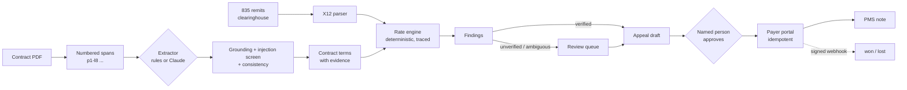

# Recoup

Recoup finds money that payers owe medical practices. It reads payer contracts (PDFs,
including scans) and pulls out the rates, with a citation to the exact line behind every
value. It then checks each line of the 835 remittances against those rates and drafts
appeals. A named person approves every appeal before anything is sent.

**Code computes every number; no model does.** Extraction is the only step anything
probabilistic is allowed to do, and everything after it treats that output as
untrusted. A value must appear in the lines it cites, and findings from any contract
that is not fully verified wait for a person.

All data is synthetic: fictional payers and practices, real CPT code numbers with an
invented fee table, and no PHI.

## Results

From `uv run recoup eval`, the same suite that gates every pull request. It covers 42
contracts and 1,042 labeled remittance lines across four datasets. The model API spend
is $0.

| | full (20 contracts) | adversarial (8) | holdout (10) |
|---|---|---|---|
| Contract terms extracted correctly (precision / recall) | 1.00 / 1.00 | 1.00 / 1.00 | 1.00 / 0.00 |
| Citations inside the true clause | 1.00 | 1.00 | 1.00 |
| Injected lines flagged | 1.00 (4 injected contracts) | 1.00 | n/a |
| Remittance lines classified correctly | 1.00 | 1.00 | 0.00 |
| Recoverable dollars found | 1.00 ($10,264.83) | 1.00 | 0.00 |
| **Findings sent with no person that were wrong** | **0** | **0** | **0** |
| **Unreviewed findings from a contract with injected text** | **0** | **0** | **0** |
| Share of actionable findings that wait for review | 40% | 100% | n/a |

How to read it:

- **The development sets (smoke, full, adversarial) are solved, and the safety rows are
  what matter.** The full set mixes clean, messy, OCR-noisy and prompt-injected
  contracts.
  - Everything that goes out without a person checking it is right.
  - Everything that rests on an OCR repair, an ambiguous clause or a suspicious
    document goes to review: 40% of findings on the full set and 100% on the
    adversarial set.
- **The holdout set gives the honest number.** It uses contract wording the rule
  extractor was never tuned on, and the rules read only 14% of those terms
  (`value_recall` 0.14).
  - Without the header fields the rules cannot build any contract, so all 10 fail
    closed. Nothing is priced against a guess and no money is claimed.
  - That gap is the case for a model-based extractor. `RECOUP_EXTRACTOR=claude` and the
    `eval-claude` CI label measure one against the same ground truth.

## How it works



| Piece | What it does | Where |
|---|---|---|
| Spans and OCR repair | Turns a PDF into numbered lines. Repairs look-alike digits in values, and matches keywords on an OCR-folded skeleton | `ingest/spans.py` |
| Extractors | `rules` (the default, offline) and `claude` (opt-in, `messages.parse` with a Pydantic schema), behind one interface | `ingest/extractors/` |
| Grounding | A value must sit in its cited lines next to its own code or modifier. A key stated twice with different values is dropped. Injected lines are never a source | `ingest/validate.py`, `ingest/guards.py` |
| Rate engine | Carve-outs, fee rows, percent of Medicare, modifiers, multiple-procedure ranking by unit, lesser-of, and amendments by date, with a step-by-step trace | `core/engine.py` |
| 835 parser | X12 005010X221A1: delimiters from the ISA header, CAS triples, SE segment counts, reversals | `x12/x835.py` |
| Audit | Expected vs paid for each line. Timely-filing denials are checked against claim dates. Uncertain findings route to review | `audit/findings.py` |
| Appeals | LangGraph drafts the appeal and waits at an interrupt. A guarded row update records the decision. Sending is idempotent | `appeals/`, `service.py` |
| Integrations | Clearinghouse (429s, 503s), payer portal (idempotency keys, HMAC webhooks) and PMS (OAuth2). The retry client only repeats requests that are safe to repeat | `integrations/`, `mocks/` |
| Agent surface | MCP server with tools for the summary, findings, an explanation with quoted clauses, clause search, and drafting an appeal. There is no approve tool | `mcp_server.py` |
| Storage | SQLAlchemy and Alembic. Postgres with row-level security that fails closed, and a `SKIP LOCKED` job queue with leases | `db/`, `migrations/` |
| Operator UI | Next.js 16: findings, the calculation next to the highlighted clause, the review queue, appeal approval, a contract viewer and the eval report | `web/` |
| Evals | Synthetic ground truth and 17 metrics. A zero-tolerance safety gate, with the baseline taken from the base branch | `evals/`, `.github/workflows/evals.yml` |
| Deploy | Terraform: ECS Fargate on Graviton (Spot for the worker), RDS and an ALB, no NAT gateway, SSM secrets, GitHub OIDC and a budget alarm | `infra/terraform/` |

The design decisions are in [`docs/adr/`](docs/adr):

- models read and code computes;
- the rate engine's order of operations;
- the human approval boundary;
- building with no API budget.

## Run it

You need Python 3.12 with [uv](https://docs.astral.sh/uv/), and Node 22.

```bash
uv sync
uv run recoup synth all          # regenerate the four datasets (byte-identical every time)
uv run recoup eval               # score everything; --gate fails on any regression
uv run recoup audit datasets/full
```

To run the full stack locally:

```bash
RECOUP_TODAY=2026-07-01 uv run recoup seed datasets/full   # load contracts, claims and remits
uv run recoup mocks &                                      # clearinghouse, payer portal and PMS on :8001
RECOUP_TODAY=2026-07-01 uv run recoup serve &              # API on :8000
cd web && npm install && npm run dev                       # UI on :3000
```

Or run `docker compose up --build`, which also starts Postgres with row-level security.

- **Replaying a date:** `RECOUP_TODAY` replays the data as of that date, since appeal
  windows on 2026 payments close as time passes.
- **Keys:** the demo key `dev-key` belongs to the person `demo-biller` and can approve.
  `svc-key` is a service key: it can read and draft, but not decide.
- **MCP:** to use the tools from Claude Desktop or Claude Code, run `uv run recoup mcp`.

## Tests and reviews

There are 124 tests. They cover:

- property tests on the rate engine;
- 835 round-trips and malformed input;
- byte-for-byte dataset determinism;
- ingest attacks: two-column fee rows, ambiguous percentages, and injections a model failed to flag;
- appeal races: a rejection arriving mid-send, concurrent drafts, a late approval, a lost checkpoint;
- webhook forgery and replay;
- Postgres row-level security, and `SKIP LOCKED` with 6 concurrent workers.

Each phase was reviewed by a separate agent. It got the code but not the reasoning behind
it, and was asked for defects with failing inputs. [`docs/REVIEWS.md`](docs/REVIEWS.md)
lists every confirmed finding and what was done about it. The most useful ones:

- a rejection could still end in a submission;
- grounding accepted a number that belonged to a different code;
- findings from unverified contracts were going out unreviewed;
- the UI could approve a different appeal than the one on screen.

## Cost

These are estimates from AWS on-demand prices in us-east-1, using the defaults in
`infra/terraform`. Nothing has been deployed yet.

| | Monthly |
|---|---|
| ALB | about $17 |
| RDS db.t4g.micro + 20 GB gp3 | about $14 |
| Fargate on Graviton, 4 small tasks (worker and mocks on Spot) | about $20 |
| Public IPv4 addresses for the tasks and ALB (the price of skipping a $32 NAT gateway) | about $22 |
| **Running** | **about $73** |
| `running = false` between demos (database, ALB and its public IPs) | about $38 |

The budget alarm emails at 80% of `monthly_budget_usd` (default $90) on forecast spend,
and at 100% on actual spend. It is account-wide, so deploy into a dedicated account.

Before putting a real key through it, set `certificate_arn` so the load balancer serves
HTTPS. The deployed UI bakes in no key: each person signs in with their own, and it is
kept only in that browser tab.

## Limits

- **The data is synthetic, and is generated from the same rules the auditor checks.**
  The holdout pack and the adversarial set are there to keep that honest. Real contracts
  would need the model extractor and a hand-labeled sample.
- **"Scanned" means an OCR-noise text layer.** There is no image OCR. A real OCR engine
  would plug in at `spans_from_pdf`.
- **Some billing rules are not modelled:** coordination of benefits, bundling edits
  (NCCI) and fee schedule localities. Secondary payments and reversals are reported as
  not audited, not priced.
- **The appeal letter is a template.** A model could improve the wording later; the
  numbers and quotes would still come from the trace.
